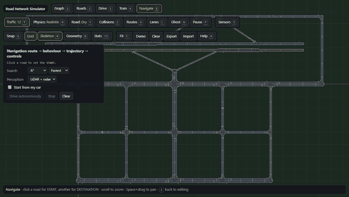
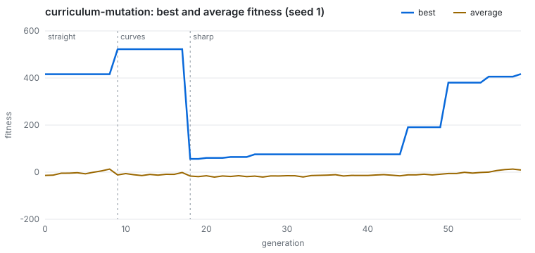

# Road Network Simulator

[](https://github.com/kgiannopoulou/road-network-simulator/actions/workflows/test.yml)


-blueviolet)
[](https://kgiannopoulou.github.io/road-network-simulator/)
[](LICENSE)

A 2D city traffic simulator and self-driving-car lab, built from scratch in plain JavaScript on one
`<canvas>`: an editable road network, vehicle physics and collisions, traffic that obeys signals and
changes lanes, simulated sensors with realistic noise, cars that learn to drive with a neural
network and a genetic algorithm, and an autonomous-driving stack that routes with A* and drives
itself from A to B through traffic.

**[▶ Open the live demo](https://kgiannopoulou.github.io/road-network-simulator/)** — press `5`,
click a start and a destination, then *Drive autonomously*. Press `4` to watch a population train.



*Navigate mode: A* finds the route, then perception → behaviour planner → trajectory planner →
controller drive the yellow car (shown 3× speed). Then Train mode: 150 cars with neural-network
brains on the first curriculum course.*

## What's inside

| Area | Implemented | Code |
| --- | --- | --- |
| **Geometry** | Points, segments, polygons, envelopes, intersections, polygon union, matrices, seeded RNG | [`math/`](src/math) [`primitives/`](src/primitives) |
| **Road graph** | Editable graph, lane layouts, procedural road surfaces and markings, kerb fillets, road types, highways with ramps | [`graph/`](src/graph) [`road/`](src/road) |
| **Simulation** | Kinematic bicycle model with tyre grip and road surfaces, SAT collisions + spatial hash, substepping | [`car/`](src/car) [`collision/`](src/collision) [`sim/`](src/sim) |
| **Traffic & city** | IDM car following, MOBIL lane changes, junction occupancy and conflicts, traffic lights, stop/yield signs, zebra crossings with pedestrians | [`traffic/`](src/traffic) [`city/`](src/city) |
| **Perception** | Ray sensor, spinning LiDAR, radar, GPS, IMU behind one API, with noise, latency, dropouts and failures; object tracking | [`sensors/`](src/sensors) [`autonomy/perception.js`](src/autonomy/perception.js) |
| **Planning** | Navigable lane graph, A* and Dijkstra over edges (turn restrictions, turn costs), behaviour state machine, Frenet quintic/quartic trajectory candidates | [`navigation/`](src/navigation) [`autonomy/`](src/autonomy) |
| **Control** | Stanley steering, speed control, all through one `car.input` interface | [`autonomy/controller.js`](src/autonomy/controller.js) |
| **Learning** | Feed-forward neural network, genetic algorithm, fitness function, six-course curriculum, Web Worker training, live dashboard | [`ai/`](src/ai) [`training/`](src/training) |

Layer diagram and design decisions: **[docs/architecture.md](docs/architecture.md)**.

## Built from scratch — no TensorFlow, no PyTorch, no libraries

There are **zero runtime dependencies** and no build step. The neural network (forward pass,
activations, weights as a genome), the genetic algorithm (tournament selection, uniform crossover,
Gaussian mutation, elitism), the physics, collision detection, the sensors, A*, Dijkstra, the
binary heap, the polynomial trajectory solver and the canvas renderer are all written by hand. The
network is never trained with backpropagation: only evolution changes its weights.

## Results

**A* vs Dijkstra** ([full table](docs/benchmarks.md), `node tools/bench-pathfinding.mjs`): both
always find routes of the same cost; for the shortest route A* expands about 75 % fewer edges.

| Network | Directed edges | Dijkstra expanded | A* expanded | Speed-up (shortest) | Speed-up (fastest) |
| --- | ---: | ---: | ---: | ---: | ---: |
| Grid 10×10 | 313 | 124 | 20 | 3.9× | 1.9× |
| Grid 40×40 | 5,441 | 2,599 | 450 | 4.2× | 1.8× |

**Training** ([docs/training.md](docs/training.md)): every run is reproducible from a JSON config
and a seed. The default settings plateau on the sharp-turns course; an experiment over network size
and mutation strength (3 seeds each) showed exploration, not network capacity, was the bottleneck.



**Autonomy:** the unit tests drive the car across the city on its own, with and without traffic, and
require arrival with zero collisions and zero red lights; a wider sweep of 36 random routes (350 m to
2.2 km, 0–30 traffic cars) arrived 36/36.

## Quick start

```bash
npm start               # serves the folder on http://localhost:8080 (or: python -m http.server 8080)
npm test                # 180 unit tests, Node ≥ 22, built-in node:test, nothing to install
npm run bench           # A* vs Dijkstra benchmark
npm run train -- configs/training/baseline.json   # headless, reproducible training run
```

ES modules don't load from `file://`, so open it over HTTP (or use the [live demo](https://kgiannopoulou.github.io/road-network-simulator/)).
Modes: `1` graph editor · `2` roads · `3` drive · `4` train · `5` navigate · `H` help. All controls:
[docs/controls.md](docs/controls.md).

## Testing

180 unit tests run in Node in about 10 seconds, on every push in CI — physics, collisions, traffic,
junctions, sensors, the neural network and genetic operators, training, routing and end-to-end
autonomous drives. The headless simulation is the same code the browser runs.

- **Edge cases** ([`edge-cases.test.js`](tests/unit/edge-cases.test.js)): disconnected maps,
  unreachable destinations, dead ends vs loops, empty maps, degenerate geometry, shapes that only
  touch, and A* = Dijkstra on 40 random networks.
- **Reproducibility** ([`train-cli.test.js`](tests/unit/train-cli.test.js)): a training config
  reproduces its committed metrics exactly.
- **Milestones as tests**: zero car-to-car collisions in a minute of busy city traffic; cars learn
  the straight course; the autonomous car completes A-to-B routes in traffic.
- **Visual tests**: an interactive geometry gallery at `/tests/visual/`.

## Documentation

| | |
| --- | --- |
| [Architecture](docs/architecture.md) | Layers, module map, design decisions |
| [Build log](docs/phases.md) | Phases 1–7, week by week: what was built and what it took to make it work |
| [Training](docs/training.md) | Reproducible configs, results, the mutation experiment |
| [Benchmarks](docs/benchmarks.md) | A* vs Dijkstra, edge cases tested |
| [Controls](docs/controls.md) | Every key and mouse action |

## Milestones

| Phase | Weeks | Milestone |
| --- | --- | --- |
| 1. Simulator foundation | 1–4 | Engine, geometry library, road graph editor, procedural roads |
| 2. Cars | 5–8 | A manually drivable traffic simulator |
| 3. Sensors | 9–12 | Rays, LiDAR, radar, GPS, IMU with imperfections |
| 4. First self-driving AI | 13–16 | Cars learn basic road following |
| 5. Training system | 17–20 | A real AI-training environment: fitness, curriculum, dashboard, fast simulation |
| 6. City simulation | 21–24 | A small functioning city: junctions, signals, lanes, highway |
| 7. Navigation | 25–28 | The autonomous car completes A → B navigation |

## Licence

MIT
