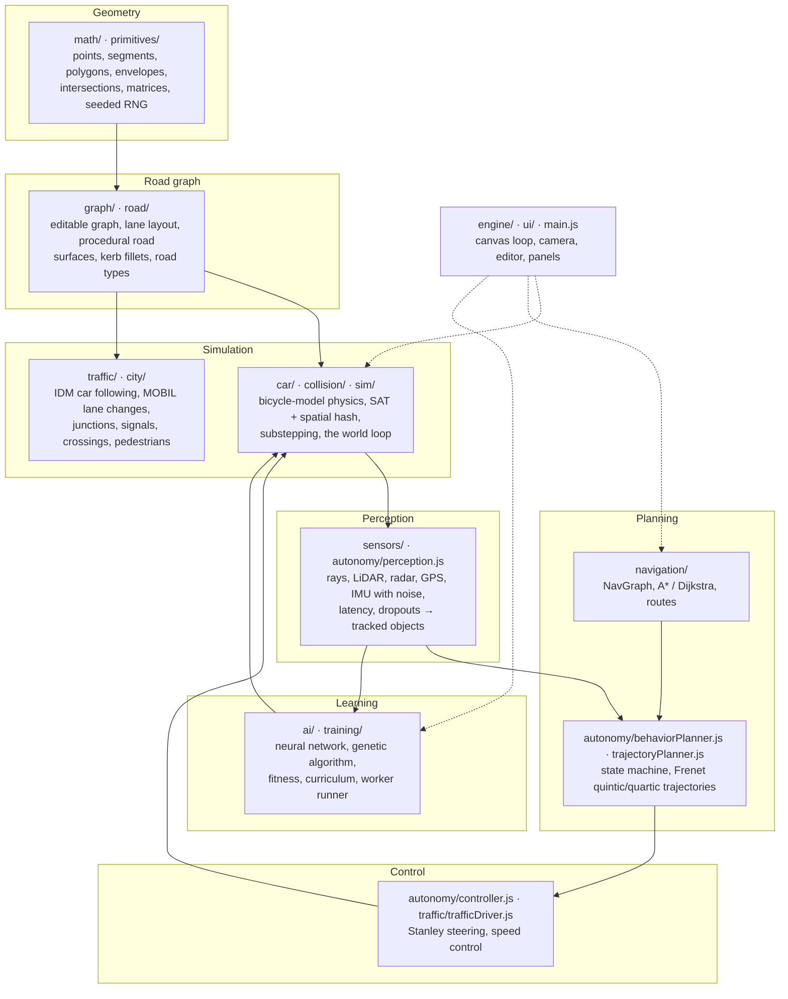

# Architecture

The simulator is plain ES modules, no dependencies, organised as layers that only talk to their
neighbours. Everything below the UI is DOM-free, so the same code runs in the browser, in a Web
Worker (training) and in Node (tests, benchmarks, headless training).



| Layer | Modules | What it owns | Talks to |
| --- | --- | --- | --- |
| **Geometry** | `math/`, `primitives/` | Points, segments, polygons, envelopes (offset outlines), segment intersection, polygon union, 2D matrices, the seeded RNG | Nothing |
| **Road graph** | `graph/`, `road/` | The editable node/edge graph and everything generated from it: lanes, road surfaces, markings, kerbs, road types and speed limits | Geometry |
| **Simulation** | `car/`, `collision/`, `sim/`, `traffic/`, `city/` | Vehicle physics, collision detection and response, traffic drivers, junction occupancy, signals, crossings, the fixed-step world update | Road graph |
| **Perception** | `sensors/`, `autonomy/perception.js` | Simulated sensors with imperfections; tracked objects with velocities. Reads ground truth, hands on only what a sensor would deliver | Simulation |
| **Planning** | `navigation/`, `autonomy/behaviorPlanner.js`, `autonomy/trajectoryPlanner.js`, `autonomy/polynomials.js` | Where to go (route on the NavGraph) and how (behaviour state, candidate trajectories, collision checks) | Perception, road graph |
| **Control** | `autonomy/controller.js`, `traffic/trafficDriver.js` | Turning a trajectory into `car.input` (steer, throttle, brake) | Simulation (`car.input`) |
| **Learning** | `ai/`, `training/` | The neural network, genetic operators, fitness evaluation, curriculum, and the session that runs on the main thread or in a worker | Perception (ray sensor), simulation |
| **UI** | `engine/`, `ui/`, `main.js` | Canvas loop, camera, input, the graph editor, HUD and panels | Everything, read-only except inputs |

The single integration point between "who drives" and the physics is `car.input`: the keyboard,
traffic drivers, the neural network and the autonomous driver all just set it.

## Project structure

```
index.html              app shell (toolbar, road panel, help, overlay)
css/style.css
src/
  main.js               wiring: loop → input → camera → editor → road network → simulation → render
  engine/               loop.js · camera.js · input.js · debug.js
  math/                 utils.js · matrix.js · random.js
  primitives/           point.js · segment.js · polygon.js · envelope.js
  graph/                graph.js · graphEditor.js · storage.js
  road/                 road.js (lane layout) · roadNetwork.js (generation + rendering, kerb fillets) · roadTypes.js
  car/                  physics.js (basic + bicycle model) · car.js · units.js · keyboardControls.js · skidMarks.js
  collision/            sat.js · spatialHash.js · collisionWorld.js (detection + response)
  traffic/              path.js · routePlanner.js · trafficDriver.js (Stanley + IDM + MOBIL) · trafficManager.js · laneIndex.js
  sensors/              sensor.js (common API) · raycast.js · raySensor.js · lidar.js · radar.js · gps.js · imu.js
                        imperfections.js · noise.js · sensorSuite.js
  city/                 city.js (junctions, lane graph, violations, drawing) · junction.js · signals.js · crossings.js
  navigation/           navGraph.js (GPS graph, map matching) · pathfinding.js (A*, Dijkstra) · route.js
  autonomy/             perception.js · behaviorPlanner.js · trajectoryPlanner.js · polynomials.js · controller.js
                        autonomousDriver.js
  sim/simulation.js     cars, substepping, collisions, city, traffic, sensors, debug drawing
  ai/                   network.js · activations.js · brain.js · genetics.js · trainer.js · coverage.js · championStore.js
  training/             courses.js · trainingWorld.js · navigator.js · fitness.js · environments.js · session.js
                        speed.js · runner.js · worker.js · trainingView.js
  ui/                   controls.js · hud.js · sensorPanel.js · trainingDashboard.js · lineChart.js · networkView.js
                        navigationPanel.js
  data/                 city.js (Phase 6 city) · demo.js (classic sample network)
configs/training/       reproducible training configurations (JSON)
results/training/       metrics, fitness charts and champions from those configs
tools/                  train.mjs (headless training) · bench-pathfinding.mjs (A* vs Dijkstra)
tests/
  unit/                 node:test suites: geometry, graph, roads, car physics, collisions, traffic, sensors, AI,
                        training, city, navigation, edge cases, reproducible training
  visual/               interactive geometry test gallery
```

## Design notes

- **World units vs pixels.** Geometry lives in world units. Editor handles are sized as `pixels / zoom`, so they stay the same size on screen at any zoom level.
- **Rebuild on change, not every frame.** The graph's `version` counter means road geometry is regenerated only when something changes, including while you drag a node.
- **Bounding-box pre-filtering** keeps polygon union and marking clipping cheap, because only nearby roads are compared.
- **One input interface for every driver.** The keyboard, traffic drivers and AI all just set `car.input`. Physics doesn't know who is driving.
- **Decide once per frame, integrate in substeps.** Drivers choose their inputs once per frame. Physics and collision resolution run in as many substeps as the fastest car needs.
- **Deterministic traffic and training.** Routes, spawns, vehicle variety, network weights and mutations all come from a seeded RNG, so tests replay exactly and a training config reproduces its metrics on any machine.
- **Layers talk only to their neighbours.** Route, behaviour, trajectory and controller each hand the next layer a small, inspectable object, which is what the navigation panel shows live.
- **One session, two hosts.** Training only talks to the page through plain-data snapshots, so the main thread, a Web Worker and the Node CLI run exactly the same code.
- **Search over edges, not nodes.** Routing runs on directed road edges, so turn restrictions (no U-turns, lane connections) are part of the graph and turns can carry a cost.
- **Ground truth and perception stay separate.** Sensors read the simulation's true state, but everything downstream gets only delivered sensor readings.

## Why JavaScript, not TypeScript

The project deliberately has no build step: open `index.html` over HTTP and it runs, and the same
files run in Node for tests. The trade-off is weaker refactoring support as it grows; the plan, if it
keeps growing, is JSDoc types checked by `tsc --checkJs` (still no build step) before a full
TypeScript port.
