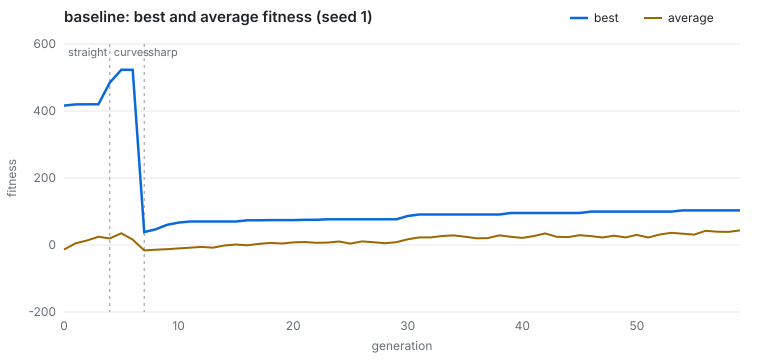

# Reproducible training

The browser's Train mode and the Node CLI run the same `TrainingSession`. Every source of randomness
— initial weights, selection, crossover, mutation, sensor noise, traffic — comes from a seeded RNG,
and the simulation advances in fixed 1/60 s steps, so **a config file and a seed fully determine a
run**. `tests/unit/train-cli.test.js` re-runs `configs/training/quick.json` and requires the exact
committed `results/training/quick/metrics.csv`.

```sh
node tools/train.mjs configs/training/baseline.json              # → results/training/baseline/
node tools/train.mjs configs/training/sharp-mutation.json --seed 2
node tools/train.mjs configs/training/quick.json --out /tmp/run  # 6 generations, < 1 s
```

Each run writes `metrics.csv` (one row per generation), `metrics.json` (config, history, course
changes, run time), `fitness.svg` (the chart below) and `champion.json` (the best network's weights).

## Config

```json
{
  "name": "baseline",
  "mode": "curriculum",
  "generations": 60,
  "passShare": 0.05,
  "passStreak": 3,
  "trainer": { "populationSize": 150, "seed": 1 }
}
```

`mode` is `curriculum` (straight → curves → sharp → obstacles → traffic → city, moving on when
`passShare` of the population reaches the destination `passStreak` generations in a row) or one
course id. `trainer` accepts everything in `TRAINER_DEFAULTS` and `GA_DEFAULTS`: `hidden` layers,
`mutationRate`, `mutationAmount`, `elitism`, `tournamentSize`, `crossoverRate`, `sensorNoise`,
`generationTime`…

## Results

### Baseline: default settings plateau on sharp turns



With the app's defaults (150 cars, a 10-8-3 network, mutation rate 0.1 and amount 0.3) the
population passes *straight* in 4 generations and *curves* in 3, then stalls on *sharp* (90° turns):
over the next 53 generations the best car improves from 38 to 103 but no car reaches the destination,
so the curriculum never moves on. 60 generations, 168,104 steps, 50 s.

### Experiment: what gets past the plateau?

The *sharp* course alone, 40 generations, 150 cars, three seeds per setting
([configs](../configs/training), [raw metrics](../results/training/experiments)):

| Setting | Best fitness (seeds 1 / 2 / 3) | Most cars arriving | First arrival (generation) |
| --- | --- | --- | --- |
| Default: 10-8-3, mutation 0.1 × 0.3 | 92 / 94 / 100 | 0 % / 0 % / 0 % | never |
| Wider: 10-16-3 | 97 / 93 / 84 | 0 % / 0 % / 0.7 % | – / – / 23 |
| Deeper: 10-12-8-3 | 360 / 404 / 90 | 0.7 % / 2.7 % / 0 % | 35 / 31 / – |
| **Stronger mutation: 0.2 × 0.5** | **435 / 397 / 446** | **5.3 % / 0.7 % / 4.0 %** | **22 / 35 / 19** |

Network size was not the bottleneck — a wider layer changed nothing and a deeper one helped on two
seeds of three. Exploration was: stronger mutation solved the course on all three seeds. The likely
reason is that with small mutations the population settles on a local optimum the fitness function
still rewards (get as far as the first turn, survive) and only bigger jumps in weight space find
the turn itself.

### Curriculum with stronger mutation


The same curriculum with mutation 0.2 × 0.5 ([config](../configs/training/curriculum-mutation.json))
spends longer on the early courses (noisier offspring), but gets past the plateau: cars reach the
end of *sharp* from generation 50 on. 60 generations, 147,134 steps, 26 s.

Next experiments worth running: adaptive mutation (raise it when the best fitness stalls), more
generations to see how far the curriculum gets, and sensor noise on (`sensorNoise: true`) to check
the champions are robust.

## Implemented from scratch

No TensorFlow, PyTorch, Brain.js or any other library: `ai/network.js` is a fully connected
feed-forward network (forward pass, activations, genome flattening) and `ai/genetics.js` the genetic
algorithm (tournament selection, uniform crossover, Gaussian mutation, elitism). There is no
backpropagation: weights are only ever changed by evolution, scored by the fitness function in
`training/fitness.js`.
